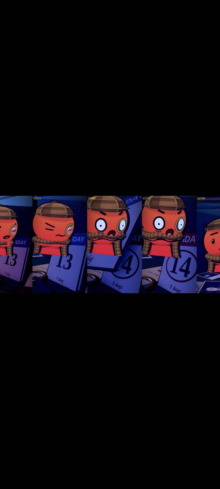
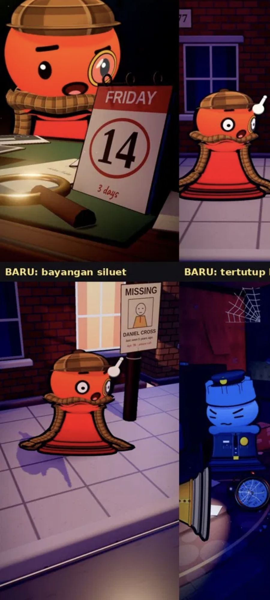
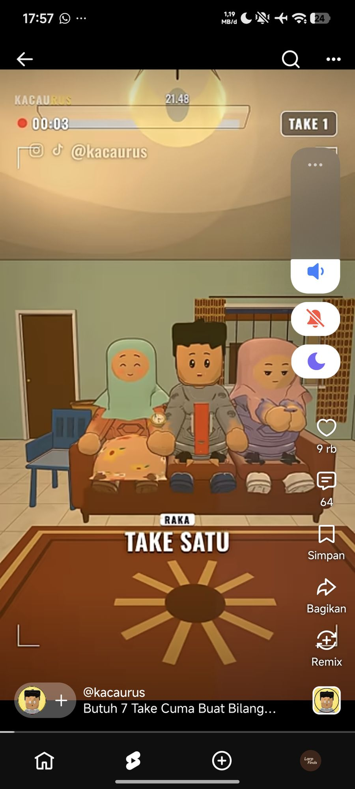

# Percakapan sesi 2: video detektif "The Photograph" (22 Nov 2026)

Ekspor transkrip sesi Claude Code: pesan user apa adanya dan balasan teks Claude, tanpa pemanggilan alat dan log teknis.
Email disembunyikan. Rangkuman arahan: `PROMPT_USER_SESI2.md`. Aturan untuk video berikutnya: `.claude/skills/pion-raja/BRIEF_KONTEN.md`.
Bagian awal sesi sempat diringkas otomatis saat konteks penuh, tetapi semua pesan aslinya tetap ada di sini.

---

### User · 2026-11-22 02:39 UTC

Lanjutkan proyek video detektif Pion Raja, episode "The Photograph", di repo ini (branch ccr-a35a51bf-0xh2wa).

Langkah awal:
1. Baca berurutan:
   - projects/the_photograph/HANDOFF.md (semua keputusan, aturan, status, cara kerja)
   - projects/the_photograph/PLAN.md (13 adegan dengan timing VO)
   - skill pion-raja: SKILL.md, ATURAN.md, PANDUAN_SINEMATIK.md §1–8, PERUBAHAN.md v6
2. Jalankan: bash projects/the_photograph/setup.sh
3. Lakukan smoke test (render still kantor), lalu cek hasilnya.
4. Lihat projects/the_photograph/tests/t5_test_v2.mp4. Itu tes hook 5 detik terakhir dan jadi patokan gaya serta kualitas.

Lanjutkan produksi, adegan demi adegan:
- Adegan 2 (4,56–10,24 dtk): amplop "NO SENDER" meluncur lewat celah pintu kantor, Pion membukanya, lalu kamera menembus foto ke apartemen terbengkalai versi A (pudar, Daniel tergeletak).
  Buat dulu set apartemen di src/scene/apartment.js dengan pola sama seperti office.js. Versi A dunia foto, B digeledah (god ray, debu), C TKP Jumat (malam, sirene merah-biru, garis polisi). Ikuti panduan environment §8.
- Lalu adegan 3–13 sesuai PLAN.md.
  Mood cahaya harus membangun tensi: normal → tension → conflict tepat di "Then Friday arrived" → reveal tepat di "It was me".
  Data kasus didekatkan ke karakter (zoom ke meja/objek), karakter tetap terlihat, kamera terbang kontinu tiap ~1,65 dtk.
- Setiap adegan:
  1. Tulis plan + cue, lalu commit.
  2. Render engine Pion (lip-sync VO), lalu render scene. Pecah rentang frame karena proses latar dibatasi 2 jam.
  3. Cek contact sheet, perbaiki kalau perlu.
  4. Commit plan, cue, dan tes adegan. Jangan commit frame mentah yang besar.
- Di akhir: overlay Remotion, SFX ElevenLabs + sfx_only.wav, rakit 73,4 dtk 1080x1920 60 fps, kirim ke user.

Sebelum adegan 2, tanyakan ke user:
1. Apakah tes hook v2 sudah oke?
2. Caption satu kata seperti di video referensi dipakai atau tidak?

Aturan: bicara Bahasa Indonesia, kirim hasil lewat SendUserFile dari scratchpad dan cek dulu sebelum kirim, jangan buat PR, simpan pekerjaan ke repo sesering mungkin.

---

### Claude · 2026-11-22 02:40 UTC

Sedang membaca dokumen serah-terima dan skill pion-raja, lanjut ke ATURAN, PANDUAN_SINEMATIK, PERUBAHAN.

Jalankan setup sekarang.

Smoke test berhasil, keempat mood tampil. Sekarang cek tes hook v2.

Semua siap: setup jalan, smoke test kantor 4 mood oke, dan hook v2 sudah saya tonton (12 frame kunci). Simpan dulu branch kerja, lalu dua pertanyaan sebelum adegan 2.

---

### User · 2026-11-22 02:41 UTC

[Jawaban atas pertanyaan pilihan Claude] "Tes hook 5 detik v2 (tests/t5_test_v2.mp4: data kasus di meja, kamera tetap dekat Pion, stempel CASE SOLVED) sudah oke untuk dijadikan patokan adegan 2–13?"="Oke, tapi ada revisi", "Caption satu kata per kemunculan (putih tebal ber-outline, ~70% tinggi frame, sinkron per kata seperti di video referensi) dipakai di video ini?"="Tanpa caption".

---

### Claude · 2026-11-22 02:43 UTC

Saya catat dulu keputusan baru di HANDOFF, lalu ukur proporsi badan Pion dari engine supaya furnitur bisa disesuaikan dengan badannya.

Runner perlu bisa memuat beberapa set (kantor, apartemen, eksterior) dalam satu plan. Saya ubah `index.html` dan `render_seq.js`: tiap frame bisa memilih `set`.

Runner multi-set selesai. Sekarang lihat timing per kata VO untuk merencanakan adegan 2 dan seterusnya.

Sedang menulis ulang proporsi set kantor (furnitur dan props seukuran badan Pion, ditambah pintu untuk amplop). Saya cek dulu gesture engine yang cocok untuk adegan "membuka amplop".

Kantor sudah diskalakan. Sebelum menambah pintu, cek kapasitas mesin dulu untuk memperkirakan waktu render.

Pintu, cahaya dari celah, dan amplop sudah ditambahkan. Sekarang render tes beberapa sudut dengan Pion probe untuk cek proporsinya.

Pintu masih menyatu dengan dinding (terlalu biru dan rata), tapi garis cahaya hangat di bawah pintu sudah bagus. Saya beri tekstur kayu, panel timbul, dan cahaya isi yang lebih netral.

Pintu sudah terbaca: serat kayu, kaca buram bertuliskan PION RAJA, dan garis cahaya di bawah pintu. Kacanya sedikit diredupkan, lalu commit dan lanjut ke set apartemen.

Mulai set apartemen. Saya lihat dulu cue Daniel dan polisi yang sudah ada, plus ekspresi mata tertutup untuk Daniel tergeletak.

Daniel perlu ekspresi mata tertutup tanpa kesan sadis. Kandidatnya `lega` dan `pusing`; saya probe keduanya dengan audio senyap supaya mulutnya tidak bergerak ikut VO.

Ada satu perbaikan kecil: arah UV berkas cahaya terbalik. Setelah itu buat probe polisi dan plan tes untuk ketiga versi apartemen.

You've hit your 5-hour limit · resets 3:50am (UTC)

---

### User · 2026-11-22 02:57 UTC

jangan pakai nama pion raja, pakai nama succify

---

### Claude · 2026-11-22 02:57 UTC

You've hit your 5-hour limit · resets 3:50am (UTC)

You've hit your 5-hour limit · resets 3:50am (UTC)

You've hit your 5-hour limit · resets 3:50am (UTC)

You've hit your 5-hour limit · resets 3:50am (UTC)

---

### User · 2026-11-22 03:50 UTC

lanjuttttttt

---

### Claude · 2026-11-22 03:50 UTC

Siap: nama di dalam video diganti jadi **SUCCIFY** (kaca pintu kantor, email di akhir, dan teks lain). Sesi sempat restart, jadi saya cek dulu apakah folder kerja masih ada.

Folder kerja masih ada. Commit apartemen dulu supaya aman, lalu cek hasil render tesnya.

Font tulisan tangan Caveat terpasang. Sekarang dipakai di semua teks tulisan tangan (kanvas 3D dan foto), lalu foto dibuat ulang dengan kamera lebih lebar.

Foto di meja tertimpa kartu foto lain. Saya angkat foto anonim ke paling atas dan geser kartu yang menimpanya.

Engine Pion jalan (516 frame). Sambil menunggu, saya tulis helper kamera bersama dan plan adegan 1–2 (kantor), juga adegan 2–3 di dalam dunia foto.

Engine sudah 120/516 frame. Sambil menunggu, saya preview kamera adegan 1–2 memakai Pion probe di frame-frame kunci.

Engine Pion adegan 1–2 selesai (516 frame, 6,7 menit) dan Daniel juga sudah. Sekarang render scene kantor (frame 0–510) lalu apartemen A (frame 492–924) di latar.

Kalender berhasil: THURSDAY 13 robek dan FRIDAY 14 terlihat. Layar laptop masih menghadap ke arah yang salah, jadi saya putar ke arah kamera.

Garis diagonal sudah hilang. Tapi render adegan 1–2 yang sedang jalan masih memakai versi lama. Saya cek apakah artefak itu muncul di frame-nya.

Pion asli bermahkota memegang ponsel/kamera sudah ada. Saya ubah jadi siluet gelap bermahkota dengan kamera dan kilat flash. Siluet ini yang akan terlihat sebagai pantulan di kaca jam.

Siluet bermahkota yang memegang kamera sudah terbaca, lengkap dengan versi berkilat flash. Sekarang saya pasang di kaca jam apartemen, plus override tint/biru untuk tensi.

Render adegan 1–2 sudah 240/511. Sekarang saya tulis semua plan dan cue tersisa (adegan 6–13) sekaligus, supaya render bisa diantrekan tanpa jeda.

Sekarang cue dan plan adegan 6–8 (apartemen B digeledah, kalender robek di "Then Friday", TKP Jumat).

Posisi dan orientasi muka jam sudah dihitung. Sekarang tulis plan adegan 9–13.

Semua plan sudah tertulis. Saya commit, lalu preview adegan 6–13 di frame-frame kunci memakai probe, supaya masalah ketahuan sebelum render panjang.

Masih ada beberapa framing yang perlu disetel: di shot "no body/no blood" muka Pion terpotong, Pion belum terlihat di ambang pintu TKP, dan muka Daniel terlalu dekat.

Antrean engine sudah jalan. Sambil menunggu, saya pelajari komponen overlay Remotion (`SceneOverlay`) untuk teks data: 11:42, FRIDAY, kartu DANIEL CROSS, dan tag NO BODY / NO BLOOD / 0 FINGERPRINTS.

Perakit film sudah siap dan mendeteksi frame yang belum dirender. Sekarang skrip overlay Remotion dan mix audio.

Mix final sekarang −13,2 LUFS dengan bed di bawah VO. Saya commit, lalu siapkan antrean render scene. Setiap adegan menunggu engine Pion-nya selesai lebih dulu.

Sekarang sekitar 4 dtk/frame per job, padahal engine sedang jalan bersamaan (sebelumnya 7 dtk). Antrean render saya jalankan lagi.

Render berjalan. Sambil menunggu, saya perbarui HANDOFF.md dengan status, keputusan baru, dan cara kerja terbaru, supaya aman kalau sesi hilang.

Sambil menunggu, saya pantau kecepatan render apartemen.

Kecepatan sekarang sekitar 3,9 dtk/frame meski engine jalan bersamaan. Apartemen A selesai kira-kira 20 menit lagi. Saya tunggu, lalu buat preview 0–15 dtk untuk dicek.

Saya tunggu notifikasi render apartemen A selesai.

Apartemen A tinggal sedikit lagi (436/445), lalu render ulang rentang 636–738. Engine s5–s8 juga sudah selesai.

Antrean berjalan normal: s23 selesai, s10 sedang dirender, dan engine sudah sampai s11. Saya buat preview 0–15,4 dtk.

Regresi terkonfirmasi: bohlam di dunia A tidak menyinari ruangan lagi. Saya cari penyebabnya dengan mematikan optimasi satu per satu.

Antrean sudah diperbarui. Sisa render sekitar 4.000 frame scene, kira-kira 4 jam. Saya cek kualitas frame awal eksterior (s5) begitu tersedia.

Pion masih terpotong karena lebar frame 9:16 sempit. Kamera saya mundurkan sedikit lagi dan targetnya digeser ke tengah antara Pion dan poster.

Sekarang Pion utuh di kiri dan poster MISSING DANIEL CROSS di kanan. Perbaikan ini akan dirender di antrean C. Saya tunggu render s5–s7 selesai.

Sambil menunggu, saya kurangi koreksi warna dunia A di perakit. Setelah bohlamnya diperbaiki, render A sudah secerah still foto, jadi cukup sedikit hangat saja.

Render adegan 1–2 selesai, adegan 3–13 berjalan di antrean. Saya tunggu notifikasi render adegan 6.

Kecepatan s5 ternyata sekitar 3,5 dtk/frame (270 frame dalam 16 menit), dan engine 4K selesai sekitar 7 menit lagi. Sisa render kira-kira 3,5 jam. Saya review tiap adegan begitu selesai.

Eksterior selesai: jalan senja, neon, Pion di trotoar, jendela 7B, lalu push ke poster "last seen 5 years ago", dan whip ke pintu. Lanjut menunggu adegan 6 (apartemen digeledah).

Saya tunggu notifikasi render adegan 6.

Semua engine Pion sudah selesai, jadi render scene sekarang lebih cepat (~2 dtk/frame). Adegan 6 hampir selesai.

Sambil menunggu, saya uji pipeline overlay Remotion di rentang kecil frame yang sudah ada (sekitar "11:42" di adegan 3).

Remotion menyalin folder public, dan frame film berupa symlink ganda sehingga tidak terbaca. Saya ganti symlink frame dengan hardlink.

Pipeline overlay Remotion sudah jalan (31 frame dalam 14 dtk). Sekarang saya tunggu render adegan 7–8 (kalender robek dan TKP Jumat).

Adegan 7 berjalan lambat: baru 25/133 frame. Saya cek apa yang memakan CPU.

Render adegan 9 dengan bayangan yang di-bake tetap benar (tension, kaca pembesar, foto di meja). Saya commit, lalu tunggu adegan 7–8.

Adegan 7 selesai dan TKP (s78) berjalan cepat, sekitar 2 dtk/frame. Saya cek adegan 7 dulu.

Adegan 7 bagus: THURSDAY 13 robek jadi FRIDAY 14, Pion syok, dan cahaya berubah ke biru konflik tepat di "Then Friday". Saya tunggu TKP (s78).

Saya tunggu notifikasinya.

Adegan 9 sudah 150/307. Sisa render sesudahnya sekitar 1,8 jam (adegan 11–13 plus render ulang dunia A). Saya tunggu notifikasi.

Laju gabungan sekarang sekitar 2,2 dtk/frame, jadi sisa ~2.070 frame selesai kira-kira 75 menit lagi. Saya tunggu notifikasi dunia A selesai.

Dunia A hampir selesai (397/445), adegan 11–13 sudah 304/1147. Saya tunggu notifikasi.

Sambil menunggu, saya cek sampel frame adegan 11–13 yang sudah jadi.

Ada sisa CPU sekitar 1,8 core. Adegan 4 saya mulai paralel dari paruh kedua frame-nya. Antrean B nanti melewati frame yang sudah ada.

Rakit potongan berjalan di latar (bangun frame, lalu overlay A dan C). Saya tunggu render adegan 4 dan 11–13 selesai.

Potongan overlay pertama (0–923) selesai, potongan C sedang dirender. Begitu paruh kedua adegan 4 selesai, paruh pertamanya langsung saya jalankan paralel.

Potongan overlay C juga sudah jadi. Saya cek item overlay-nya (11:42, kartu DANIEL CROSS, tag NO BODY, FRIDAY, foto di atas TKP, 11:42 kedua) dari frame hasil Remotion.

Saya uji item baru di beberapa frame (11:42 di adegan 3, DANIEL CROSS, NO BODY, FRIDAY).

Render hampir selesai: adegan 11–13 di 1100/1147, adegan 4 di 294/343. Begitu lengkap, saya rakit potongan B dan D lalu sambung semuanya.

---

### User · 2026-11-22 08:46 UTC

[1 gambar dilampirkan]

contohnya ini nih, itu kalender kena tutup sama karakternya kan,nah karena itu aku pengen kamu bener bener masukkin karakternya kedalam video, agar bisa kena efek fisikanya juga kan, tapi itu bakal rerender gak? kalau bakal rerender, mending ini buat advice next konten dan masukkin kedalam repo kita

atau mungkin kalau boleh revisi aja bagian yang error error kayak pas kalender ketutupan

---

### Claude · 2026-11-22 08:53 UTC

Panduan sudah tersimpan di skill (`PANDUAN_INTEGRASI3D.md`) dan ditautkan dari SKILL.md dan HANDOFF.md. Saya tunggu render ulang adegan 7 dan hook selesai, lalu rakit film.

Adegan 7 selesai dirender ulang, potongan hook masih jalan. Sambil menunggu, saya rakit frame film dan render overlay untuk bagian yang sudah final (924–4403).

Semua potongan overlay sudah jadi. Saya cek dulu hasil render ulang kalender, lalu sambung keempat potongan dan mux dengan audio.

Kalender sekarang berada di depan Pion, dan halaman yang robek terbang melewati depannya, sesuai urutan fisiknya. Total frame keempat potongan pas 4.404. Saya sambung dan mux dengan audio.

Video final sudah dirakit: 73,4 dtk, 1080x1920, 60 fps, 4.404 frame. Sebelum dikirim, saya review contact sheet seluruh video.

Ada masalah serius di adegan 4 (sekitar 17–20 dtk): frame hampir hitam dan Pion tidak muncul, padahal di situ dia harus memegang foto. Saya periksa frame s4 langsung.

Masih "SUBSCRIBE". Saya baca cara engine mem-parse baris `paperimg`.

Sedang memperbaiki engine: kertas yang dipegang Pion di adegan 4 masih menampilkan teks bawaan karena gambarnya baru dimuat saat frame pertama digambar. Saya buat props diinisialisasi lebih awal.

Kertas sekarang menampilkan "Find him before Friday." dengan tulisan tangan. Saya jalankan rantai render ulang adegan 4 (engine 4K → scene → overlay B → sambung → mux) di latar.

Rantai perbaikan adegan 4 berjalan (sekitar 30 menit). Sementara itu saya cek detik-detik terakhir video: snap ke jam dinding 11:41 → 11:42, lalu layar hitam.

Perbaikan adegan 4 dan akhir video berjalan berurutan, sekitar 35 menit. Saya tunggu sampai selesai.

Log lama masih berisi "done", jadi pengecekan tadi terpicu terlalu cepat. Saya tunggu penanda akhir rantai perbaikan.

Engine adegan 4 selesai (8 menit), scene-nya 59/343 frame. Total sisa sekitar 30 menit termasuk overlay dan sambung ulang.

Perbaikan akhir video sudah selesai. Close-up adegan 4 sudah 90/217 frame, lalu overlay B dan penyambungan final. Sekitar 12 menit lagi.

True peak setelah encode AAC +0,8 dBTP, sedikit di atas batas. Audio saya re-encode dengan limiter −1,5 dBTP; video cukup disalin tanpa render ulang.

Video final "The Photograph" sudah saya kirim: 73,4 detik, 1080x1920, 60 fps, plus `the_photograph_sfx_only.wav` (musik dan SFX tanpa VO). Sebelum dikirim, contact sheet seluruh video sudah saya cek. Audionya −14,5 LUFS (standar Shorts), dan bed musik ada di bawah suara narasi.

**Soal kalender yang tertutup Pion**
- **Bagian yang error sudah saya revisi tanpa render ulang semuanya.** Sekarang kalender, laptop, dan kaca pembesar di kantor benar-benar menutupi Pion. Halaman kalender yang robek juga terbang lewat di depannya.
- **Memasukkan karakter sepenuhnya ke dunia 3D (bayangan asli, fisika, tertutup objek di semua set) butuh render ulang semua adegan.** Jadi itu saya tulis sebagai panduan untuk konten berikutnya di `.claude/skills/pion-raja/PANDUAN_INTEGRASI3D.md`, dan sudah ditautkan dari SKILL.md dan HANDOFF.md.
- **Di apartemen dan eksterior, pass oklusi itu belum dipasang.** Di sana saya hanya mengatur posisi supaya tidak ada objek di antara kamera dan karakter.

**Arahan kamu yang sudah diterapkan**
- **Dunia seukuran badan Pion.** Kursi wingback, props meja diperbesar 1,5x, plafon, rak, dan pintu dibuat seukuran Pion. Polanya sama di apartemen dan eksterior.
- **Tanpa CASE SOLVED dan tanpa caption.** Teks overlay hanya data: 11:42, DANIEL CROSS · MISSING 5 YEARS, NO BODY / NO BLOOD / 0 FINGERPRINTS, dan FRIDAY. Teks di layar laptop dan di foto ada di dalam dunia 3D.
- **Nama di dalam video SUCCIFY.** Muncul di kaca pintu kantor dan sebagai email pengirim (succify@succify.mail).

**Alur cahaya**
Mood bergerak dari normal ke tension (biru naik saat penggeledahan), lalu patah ke conflict tepat di "Then Friday": kalender THURSDAY 13 robek jadi FRIDAY 14, ada petir dan sirene. Di "It was me" berubah ke reveal: ruangan gelap dengan cahaya dingin dari bawah.

**Error yang saya temukan saat review dan sudah diperbaiki**
- **Adegan 4:** Pion sempat hilang dari frame, lalu lembaran yang dipegangnya menampilkan teks bawaan "SUBSCRIBE". Sekarang benar: Pion memegang belakang foto bertuliskan "Find him before Friday."
- **Dunia di dalam foto (adegan 3 dan 10):** sempat gelap karena bohlamnya tidak menyala. Sudah dirender ulang dengan bohlam menyala.
- **Akhir video:** jam dinding terlalu gelap sehingga perpindahan 11:41 → 11:42 tidak terbaca. Sekarang diberi lampu sorot.
- **Engine:** perbaikan `paperimg` dan skala render 4K juga sudah saya simpan di skill pion-raja, jadi episode berikutnya tidak kena masalah yang sama.

Semua plan, cue, set, skrip, dan SFX sudah di-commit dan di-push ke branch `ccr-fc580678-x4yiq9`. Frame mentah tidak di-commit.

---

### User · 2026-11-22 10:13 UTC

buat karakternya benar benar ada didalam video, bukan cuma kayak ditempel tanpa ada hukum fisika, shadow, pantulan cahaya, dll, itu juga tadi kayak ada karakterku itu ada framenya bentuk kotak, jadi kayak ada yang dipotong

---

### Claude · 2026-11-22 10:16 UTC

Siap. Untuk memasukkan karakter benar-benar ke dalam dunia 3D, semua adegan harus dirender ulang. Engine Pion tidak perlu diulang, cukup render scene-nya, kira-kira beberapa jam.

**Soal kotak/potongan yang kamu lihat:** itu memang ada. Penyebabnya, badan Pion dipotong garis lurus (clipping plane) di belakang meja. Dari sudut kamera rendah, potongan lurus itu terlihat melayang di atas meja.

Rencana perombakan, untuk semua set (kantor, apartemen, eksterior):
1. **Oklusi kedalaman penuh, tanpa clipping plane.** Karakter tertutup objek apa pun di depannya: meja, kalender, kusen pintu, garis polisi. Potongan kotak hilang.
2. **Bayangan asli.** Karakter menjatuhkan bayangan ke kursi, meja, lantai, dan dinding dari lampu utama set: lampu gantung, sinar matahari di celah papan, matahari senja.
3. **Disinari lampu set.** Karakter menerima cahaya dan bayangan dari lampu di sekitarnya: belang god ray, strobo merah-biru, lampu bawah saat reveal, kabut ruangan.
4. **Fisika.** Lompatan Pion parabolik dengan gravitasi, debu mengepul saat mendarat, dan bayangan kontak mengecil saat dia di udara. Halaman kalender yang robek jatuh dengan gravitasi dan berputar sampai mendarat di meja.

Saya mulai dari pengecekan fitur three.js yang dibutuhkan.

Sedang memasang karakter ke dalam dunia 3D. Ada satu galat kecil: fungsi bake memanggil peta bayangan di luar siklus render. Saya ganti dengan render depth-only ke target 1x1 piksel, sehingga murah.

Bibir alas Pion sekarang utuh di ketiga set. Tapi bayangan jatuhnya dari matahari senja belum terlihat di trotoar. Saya debug proxy bayangannya dengan membuatnya terlihat sementara.

Proxy sudah berada di posisi yang benar dan menghadap matahari (kotak hijau debug). Berarti masalahnya ada di pass bayangan. Saya uji tanpa alpha map untuk memisahkan penyebabnya.

Ketemu petunjuk penting: setelah render, `dusk.shadow.map` masih null. Artinya three.js tidak pernah membuat peta bayangan untuk lampu ini. Saya baca kode `WebGLShadowMap.render` di r186.

Kode three.js terlihat normal, jadi lampu itu tidak pernah masuk daftar bayangan. Saya cek apakah lampu di kantor dan apartemen juga sama: apakah bayangan pernah bekerja sama sekali di proyek ini.

Tes terhenti di tengah jalan. Sisanya saya jalankan di latar.

Lompatan sekarang setinggi sekitar 17–19 cm, dengan squash 0,88 saat mendarat dan debu di setiap pendaratan. Sekarang fisika halaman kalender.

Kalender sekarang fisik: robek, terbang dengan gravitasi sambil berputar, mendarat, lalu meluncur di atas alas kulit. Saya jalankan batch tes semua set dengan `nohup`.

Batch tes masih jalan; adegan kantor sudah jadi. Saya cek dulu kalender yang jatuh dan Pion di kantor.

Kalender bekerja sesuai rencana: halaman robek terbang ke arah kamera lalu jatuh keluar frame, dan Pion tetap di belakang kalender. Saya tunggu sisa batch (apartemen dan eksterior).

Render ulang penuh sudah berjalan. Saya cek lajunya setelah beberapa menit.

Render baru jalan sekitar 30 detik (6 frame). Saya cek lajunya lagi sebentar.

---

### User · 2026-11-22 10:38 UTC

kasih backsound yang cocok untuk video misteri gini, terus volume voice overnya buat 1000,yang awalnya itu 100

terus mungkin advice untuk next content ya, kamu bisa gak kayak langsung masukkin karakternya dalam dunia 3d itu, kayak itu kan masih kamu tempel gitu, jadi kurang realistis cahaya sama shadownya, terus mungkin buat style pakaiannya lebih cartoonish gitu, ini buat next content, skrng lakukan perintah awal itubaja

---

### Claude · 2026-11-22 10:39 UTC

Dua loop pertama berhasil. Yang ketiga gagal 401, mungkin kuota atau gangguan sesaat. Saya coba sekali lagi.

Kuota ElevenLabs tersisa sedikit (9.207 dari 10.000 kredit terpakai), tidak cukup untuk loop 30 detik. Saya coba loop ketiga yang lebih pendek (15 detik), lalu diulang.

Di jeda tanpa suara, musik masih terlalu pelan (−41 dB). Target musik saya naikkan ke −24 LUFS, sekitar 11 dB di bawah VO, supaya backsound terasa tapi suara tetap dominan.

Sudah saya kirim **the_photograph_v2.mp4** dan **the_photograph_v2_sfx_only.wav** (musik + SFX tanpa VO). Visualnya sama dengan v1, yang berubah audionya.

**Backsound misteri**
Music API ElevenLabs tidak bisa dipakai di akun gratis, jadi musiknya saya buat dari loop SFX dalam tiga bagian:
- **0–28 dtk:** pizzicato dan piano pelan dengan detak jam, suasana penyelidikan.
- **28–54 dtk:** ostinato senar dan timpani seperti detak jantung, makin tegang sampai "Then Friday".
- **54 dtk sampai akhir:** kotak musik mencekam di atas dengung dingin, untuk "It was me".

**Voice-over 100 → 1000**
- VO sekarang jauh lebih keras dari semuanya: suara di −13 LUFS, musik sekitar 11 dB di bawahnya, SFX di bawahnya lagi.
- Kalau dinaikkan mentah +20 dB, suaranya pecah. Jadi VO saya kompres ringan lalu naikkan sekeras mungkin tanpa distorsi (limiter −1,5 dBTP). Hasil akhir −13,4 LUFS, standar keras untuk Shorts.
- Di sekitar detik 3,8–4,4 musiknya memang hening sebentar. Jeda itu bagian dari loop dan pas dengan jeda sebelum "It all started", jadi saya biarkan.

**Saran konten berikutnya**
Sudah saya tulis di `.claude/skills/pion-raja/PANDUAN_INTEGRASI3D.md`:
- **Karakter langsung jadi model 3D** di scene yang sama, bukan kartu 2D yang ditempel.
- **Cahaya dan bayangan realistis:** bayangan dari setiap lampu, pantulan warna dari lingkungan, rim light.
- **Baju lebih kartun:** tebal, siluet dibesar-besarkan, blok warna cerah, jahitan tegas.
- **Patokan level audio** seperti di atas.

**Perlu keputusanmu:** render ulang penuh dengan karakter yang dimasukkan ke dunia 3D (permintaanmu sebelumnya) masih jalan di latar dan selesai sekitar 4 jam lagi.
- Hasilnya: tidak ada lagi potongan kotak, karakter tertutup objek di depannya, bayangannya jatuh ke lantai, kena belang god ray, debu saat mendarat, dan halaman kalender jatuh dengan gravitasi.
- Pengecekan otomatis sudah saya jadwalkan. Begitu selesai, saya rakit jadi v3 dengan audio baru ini lalu kirim.
- Kalau kamu cukup dengan v2 dan model 3D asli untuk konten berikutnya saja, bilang saja dan render itu saya hentikan.

Kuota ElevenLabs tinggal sedikit (9.207 dari 10.000 kredit), jadi pembuatan SFX atau musik baru terbatas sampai kuota di-reset.

---

### User · 2026-11-22 10:45 UTC

oke dah bagusss, sekarang kamu cerna perintah yang advice itu, lalu masukkan semua hasil promptingku ini, hasil codinganmu yang aku approve, terus masukin ke repo, agar nanti kalau aku buat videoke 2 jadi bagus, kayak karakternya yang masuk kedua 3d dengan cahaya dan shadow yang bagus, bukan seperti video ini, bayangannya hampir gaada

---

### Claude · 2026-11-22 10:45 UTC

Siap. Rencananya:
1. **Hentikan render ulang di latar** karena v2 sudah oke, dan batalkan pengecekan terjadwal.
2. **Rangkum semua arahanmu** dari awal proyek sampai sekarang jadi satu brief yang wajib dibaca untuk video ke-2.
3. **Simpan kode yang sudah kamu approve** sebagai template siap pakai di skill pion-raja.
4. **Buat prototipe karakter 3D asli** (Pion sebagai model 3D di dalam dunia three.js, bukan kartu tempel) dengan bayangan nyata, dan buktikan lewat render tes. Dengan begitu video ke-2 tinggal melanjutkan.

Ada dua koreksi di kode wajah: posisi monokel (harus di mata kanan dari sisi penonton) dan orientasi tutup wajah. Setelah itu saya pasang Pion 3D ke kantor sebagai opsi (`F.pion3d`) dan uji render.

---

### User · 2026-11-22 10:48 UTC

tapi aku masih mau keliatan kayak 2d, kalau kamu tahu referensi videonya ya, yang aku kirim 15 video itu

---

### Claude · 2026-11-22 10:48 UTC

Prototipe 3D belum masuk repo. Saya kembalikan `office.js` ke versi terakhir yang di-commit (tanpa hook 3D) dan hapus file prototipenya.

Label di papan saling bertumpuk. Saya perpendek, lalu lanjut menulis brief.

Sekarang dokumen inti: **BRIEF_KONTEN.md**, berisi semua arahan dan keputusanmu dari sesi 1 sampai sekarang, sebagai checklist wajib untuk video berikutnya.

Sekarang `PANDUAN_INTEGRASI3D.md` saya tulis ulang. Arahnya kini jelas: tetap 2D seperti referensi, dengan bayangan dan cahaya nyata lewat `charlayer`. Rekomendasi model 3D dihapus.

Tinggal menautkan semuanya: SKILL.md (dibaca otomatis tiap sesi), HANDOFF.md, dan arsip arahanmu dari sesi ini. Setelah itu commit dan push.

Semua arahan dan kode yang kamu setujui sudah masuk repo dan di-push ke branch `ccr-fc580678-x4yiq9`. SKILL.md sekarang menyuruh sesi berikutnya membaca brief ini lebih dulu.

**Soal tampilan 2D**
Prototipe model 3D sudah saya buang dan tidak masuk repo. Arah untuk video ke-2: karakter tetap gambar 2D seperti 15 video referensi, tapi benar-benar ada di dalam dunia 3D. Caranya lewat `charlayer.js`, yang sudah terpasang dan diuji di ketiga set:
- **Tertutup objek di depannya.** Meja, kalender, kusen pintu, dan garis polisi menutupi karakter. Potongan kotak tidak ada lagi.
- **Bayangan siluet asli** jatuh ke lantai atau dinding dari lampu yang paling dominan di dekat karakter.
- **Ikut cahaya set:** warna lampu, strobo, dan belang god ray.
- **Fisika:** lompatan parabola dengan gravitasi, debu saat mendarat, dan benda jatuh dengan gravitasi.

Papan perbandingan yang barusan saya kirim memperlihatkan bedanya: kiri atas video ini, sisanya versi baru. Gambar versi baru masih still uji, belum video utuh.

**Yang tersimpan di repo**
- **`BRIEF_KONTEN.md`:** semua aturanmu dari sesi 1 dan 2 dalam satu checklist:
  - cara kerja, gaya 2D, dunia seukuran Pion, bayangan harus jelas, baju lebih kartun;
  - mood cahaya, tanpa caption, teks data besar, nama SUCCIFY;
  - VO keras plus backsound sesuai genre;
  - jebakan teknis yang sudah ketemu supaya tidak terulang.
- **`PANDUAN_INTEGRASI3D.md`:** cara kerja `charlayer` dan checklist supaya bayangannya benar-benar terlihat. Contohnya: pilih lampu yang dominan di posisi karakter, taruh karakter di jalur cahayanya, atur kamera supaya bayangan masuk frame.
- **`examples/proj10_photograph/`:** template siap pakai berisi kode yang kamu setujui. Isinya tiga set, runner render, plan kamera, perakit film, teks Remotion, mixer audio (VO −13 / musik −24 / SFX −25 LUFS), daftar SFX, dan tools.
- **`PROMPT_USER_SESI2.md`:** arsip arahanmu sesi ini secara urut waktu. HANDOFF.md juga sudah diperbarui.

**Catatan:** video v2 yang sudah kamu setujui masih memakai versi kartu lama. Render ulang dengan `charlayer` sudah saya hentikan, dan pengecekan terjadwalnya juga sudah saya batalkan, karena integrasi ini untuk video ke-2.

Kuota ElevenLabs tinggal sekitar 800 dari 10.000 kredit. Di brief sudah saya catat supaya video berikutnya memakai ulang SFX yang ada sampai kuota di-reset.

---

### User · 2026-11-22 10:55 UTC

[1 gambar dilampirkan]

nah ini maksudku, lihat foto kiri bawah, peletakan kakinya, kayak gk nginjak tanahkan, itu karena kamu cuma nempel, gak ngatur posisi, jadi misal diambil dari sudut kamera yang gak sejajar, malah kayak dia lurus didepan kamera, tapi tanahnya itu agak turun gitu, paham kann

---

### Claude · 2026-11-22 10:55 UTC

Paham. Engine menggambar Pion dari kamera setinggi mata (tampak depan lurus). Saat kamera adegan melihat dari atas, lantai terlihat menurun ke belakang, sementara Pion tetap tampak depan, seperti berdiri tegak di depan lensa, tidak menginjak tanah. Jadi bukan cuma bayangan: **sudut pandang gambar karakter harus sama dengan sudut kamera adegan**.

Kalau kamera menunduk 30°, Pion juga harus digambar dari atas 30°: alasnya tampak elips seperti menapak lantai dan bagian atas topinya terlihat. Kartunya juga harus menghadap kamera penuh, dengan titik alas tepat di titik kontak lantai.

Engine sebenarnya punya opsi `--view` (orbit/tilt kamera per frame). Saya cek apakah opsi ini jalan dengan `style2d`.

Opsi `--view` didukung `style2d` (kamera perspektif sempit 18° plus tilt dan orbit). Saya cek konvensi tanda tilt dan orbit dari contoh proj8.

Sekarang alat `make_view.js` yang menghitung `[orbit, tilt]` per frame dari plan adegan, lalu tes ulang perbandingannya.

Papan patokan sudut sudah jadi. Sekarang aturan ini saya tulis ke panduan dan brief, lalu commit dan push.

---

### User · 2026-11-22 10:58 UTC

[1 gambar dilampirkan]

@"/root/.claude/uploads/599c6978-6adb-511d-9baf-eb7e4a5a98d4/4a5b529c-How_One_Cart_Stopped_an_Entire_Army.mp4" sama video tadi, ternyata ada beberapa sfx yang volumenya kurang tinggi, buat serame mungkin videonya, tapi tetap terasa misterious, sama mungkin kasih caption kayak, misal narator yang ngomong, itu kasih polos kayak referensi yang aku kirim,namun misal karakter dalam video yang ngomong, itu kasih kayak nama gitu, kayak foto yang aku kirim, jadi nama "succify" terus bawahnya baru teks

---

### Claude · 2026-11-22 11:02 UTC

Pemulihan berjalan (62/152). Sambil menunggu, potongan overlay B, C, dan D (yang tidak bergantung pada adegan 1–2) saya render di latar.

Sambil overlay dirender, aturan baru saya catat di brief dan semua kode di-commit.

Overlay gagal karena path font dan `vo_stt.json` dihitung dari lokasi symlink, bukan file aslinya. Saya pakai `realpath`, lalu jalankan ulang antreannya.

`mix_film.py` dan `build_film.py` aman karena di folder kerja path-nya juga ada lewat symlink. Antrean overlay jalan lagi, kira-kira 25 menit. Saya cek sebentar lagi.

Saya pantau render overlay dan pemulihan frame. Notifikasi akan masuk saat tiap potongan selesai.

Notifikasi tadi berasal dari log lama percobaan pertama yang gagal. Antrean yang baru masih berjalan, jadi saya tunggu event berikutnya.

Antrean berjalan normal: overlay B sedang dirender, pemulihan frame 60/152. Saya tunggu notifikasi.

Saya tunggu overlay B selesai untuk mengecek tampilan caption-nya.

Sambil menunggu, saya render dua still Remotion untuk mengecek tampilan dua gaya caption: bernama di 17 dtk (Pion memegang foto) dan polos di 12 dtk (jam di dunia foto).

Begitu semua potongan selesai, saya sambung, pasang audio v3, cek, lalu kirim.

Overlay masih dirender, sekitar 20–25 menit lagi. Saya lanjut otomatis begitu notifikasinya masuk.

Semua perubahan sudah di-commit dan di-push. Overlay B selesai, sedangkan C, D, dan A masih dirender. Saya lanjut begitu semuanya selesai.

Overlay B sudah jadi. C, D, dan A masih berjalan, dan saya teruskan begitu notifikasi berikutnya masuk.

Pemulihan frame adegan 1–2 selesai. Saya cek dulu apakah gayanya sudah konsisten dengan v2.

Frame adegan 1–2 yang dipulihkan sudah sama dengan gaya v2. Sekarang potongan D dirender, lalu A. Sambil menunggu, saya cek status repo.

Repo sudah bersih. Proses tunggu `ov3.done` masih berjalan di latar dan akan memberi tahu saya begitu selesai.

Saya menunggu potongan overlay D dan A selesai dirender. Setelah itu saya gabungkan dengan audio v3, cek LUFS dan caption-nya, lalu kirim videonya.

Potongan D selesai, tinggal A (build_film 0–924 lalu overlay).

4404 frame, 1080x1920, 60 fps; loudness -12,9 LUFS, true peak -1,3 dBTP. Sekarang saya cek caption di video jadinya.

Hampir semua benar, tapi di detik 62 Pion terlihat besar di layar sementara caption-nya masih polos ("taken on"). Saya cek deteksinya.

Hasilnya sama persis, jadi data asli `s1113` sendiri yang menyimpang. Saya lihat lebih dekat.

Ada 5 caption yang berubah. Saya cek dulu apakah Pion memang terlihat di frame-frame itu.

Kelima caption itu memang muncul saat Pion terlihat, jadi aturan baru lebih tepat. Saya render ulang potongan B, C, dan D.

Saya sedang merender ulang tiga potongan overlay (perkiraan sekitar 10 menit). Setelah selesai, saya gabungkan lagi dengan audio v3, cek ulang hasilnya, lalu kirim.

Kegagalannya hanya di perintah `tail` saya; ketiga potongan sudah selesai. Sekarang saya gabungkan dan cek.

Semua sudah benar. Saya kirim videonya.

The Photograph v3 sudah jadi dan terkirim, ditemani file `sfx_only.wav` (musik + SFX tanpa VO). Durasinya 73,4 detik, 1080x1920, 60 fps. Saya sudah cek sampel frame dan mengukur loudness-nya sebelum mengirim.

**Caption**
- **Narator, atau Pion tidak terlihat:** teks polos putih huruf kecil dengan outline tipis, seperti video referensi "How One Cart…".
- **Pion bicara dan terlihat di layar:** label putih kecil "SUCCIFY" di atas, lalu teks besar KAPITAL di bawahnya, seperti foto RAKA.
- Label dipasang otomatis kalau kepala Pion terlihat di layar selama minimal 40% durasi potongan kata. Hasilnya 48 dari 126 caption memakai label.
- Saat mengecek, ada 5 caption yang seharusnya berlabel tapi masih polos. Penyebabnya: label hanya ditentukan dari frame pertama, padahal di situ kamera sering masih bergerak ke arah Pion. Itu sudah saya perbaiki dan render ulang.

**SFX dan audio**
- **Semua file SFX disamakan tingkat kerasnya dulu**, jadi tidak ada lagi yang tenggelam.
- **Efek baru:**
  - whoosh di setiap gerakan kamera (11 tambahan);
  - suara naik menegang (riser) sebelum setiap belokan cerita;
  - hentakan bass + klik setiap teks data muncul ("11:42", "NO BODY", dll).
- **Level:** VO tetap paling keras (-13 LUFS), lalu SFX (-18), lalu musik misteri (-22). Hasil akhir -12,9 LUFS, puncak -1,3 dBTP.

Catatan kecil yang masih ada:
- Di detik 44,5, "11:42" muncul dua kali sekaligus, sebagai teks data di atas dan sebagai caption di bawah.
- Di detik ±24,7, label SUCCIFY sudah tampil saat Pion baru masuk dari bawah layar.

Gambarnya sama dengan v2 yang sudah kamu setujui. Kode dan aturan caption sudah masuk repo dan di-push, termasuk di brief untuk video berikutnya.

---

### User · 2026-11-22 11:33 UTC

masih ada error sih, tapi gpp, gausah direvisi, masukin kerepo aja

---

### Claude · 2026-11-22 11:35 UTC

Kualitas salinannya masih bagus. Saya perbarui HANDOFF lalu commit.

Oke, video v3 sudah masuk repo dan sudah di-push ke branch `ccr-fc580678-x4yiq9`. Tidak ada perubahan yang tertinggal.

Yang masuk repo:
- **`projects/the_photograph/final/the_photograph_v3.mp4`**:
  - File asli 180 MB, melebihi batas GitHub (100 MB per file). Jadi yang masuk salinan yang dikompres ulang: 32 MB.
  - Resolusi dan frame tetap sama: 1080x1920, 60 fps, 4404 frame. Saya sudah cek sampel frame dan gambarnya masih tajam.
  - File aslinya (kualitas lebih tinggi) tetap yang tadi saya kirim lewat chat.
- **`projects/the_photograph/final/the_photograph_v3_sfx_only.wav`**: musik + SFX tanpa VO.
- **`projects/the_photograph/HANDOFF.md`**:
  - v3 dicatat sebagai versi final, dengan keterangan masih ada error kecil yang sengaja tidak direvisi.
  - Dua yang saya temukan juga dicatat: "11:42" muncul dua kali di detik 44,5, dan label SUCCIFY muncul saat Pion baru masuk frame di sekitar detik 24,7.

Kalau mau, sebutkan error yang kamu lihat. Saya catat di brief supaya tidak terulang di video ke-2, tanpa mengubah video ini.

---

### User · 2026-11-22 11:37 UTC

divideo itu, seharusnya cuma pakai sudut pandang narator, jadi gausah ada nama

---

### Claude · 2026-11-22 11:37 UTC

Sekarang dokumen aturannya:

Aturannya sudah saya perbaiki di repo dan di-push. Video v3 tidak saya render ulang, sesuai permintaanmu tadi.

- **Aturan baru:** narasi selalu pakai caption polos, termasuk narasi orang pertama oleh Succify ("I checked…", "It was me"), walaupun dia terlihat di layar dan bibirnya bergerak.
- **Label nama "SUCCIFY":** hanya untuk dialog di dalam adegan, misalnya saat dia bicara ke karakter lain. Rentang waktunya diisi di `DIALOG` dalam `overlay_film.py`. Untuk The Photograph isinya kosong, jadi sekarang 0 dari 126 caption berlabel.
- **Dokumen yang diperbarui:** `BRIEF_KONTEN.md` §5, kode template video berikutnya, `HANDOFF.md`, dan catatan prompt kamu (item 11–12). Di brief juga ada aturan untuk bertanya ke kamu di awal kalau naskah mencampur narasi dan dialog.

Kalau mau versi v3 tanpa label nama, saya bisa render ulang overlay-nya. Gambar dan audionya tetap sama, prosesnya sekitar 10 menit.

---

### User · 2026-11-22 11:40 UTC

belum kamu masukkin kerepo ya percakapan kita ini? tentang animasi detik ktif

---

### Claude · 2026-11-22 11:40 UTC

Sebagian sudah masuk, tapi belum lengkap. Saya cek dulu apa yang sudah ada di repo dan transkrip mana yang masih tersedia.

Hanya 11 pesanmu yang terbaca, padahal seharusnya lebih banyak. Kemungkinan pesan yang kamu kirim saat saya sedang bekerja tersimpan dalam format lain. Saya cek.

Jawaban kamu atas pertanyaan pilihan di awal sesi ("Oke, tapi ada revisi" / "Tanpa caption") belum masuk. Saya cari format penyimpanannya.

Ada satu entri yang salah terbaca, yaitu output perintah cari saya sendiri. Saya perketat filternya.

Pesanmu sekarang lengkap: 14 entri, termasuk jawaban pilihan. Saya simpan juga gambar-gambar yang kamu lampirkan supaya konteksnya utuh.

Semua gambar aman disimpan: tangkapan frame video dan foto referensi RAKA. Saya simpan juga skrip ekspornya di repo supaya sesi berikutnya bisa melakukan hal yang sama, lalu commit.

